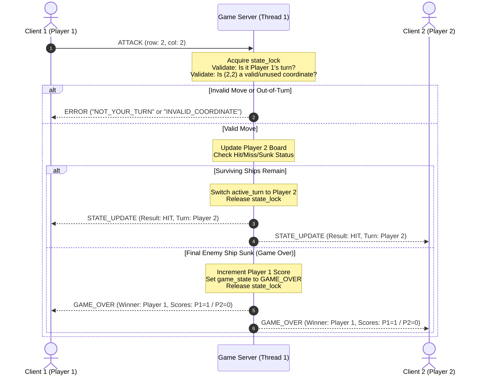

# CS457 Project Concurrency Design

## 1. Server Concurrency Model Selection

For the handling concurrency on the server with multiple clients I will be using Multi-Threading. Specifically the threading module in python which provides a high level interface for creating and managing threads concurrently. The Battleship game will have two players connected during a given session, meaning two threads will need to be created and managed by the server for the two client sockets.

The decision to use threads for the concurrency comes down to a few things. One is it provides a convenient way to block at an individual client/socket level instead of up at the server level freezing up network activity while waiting for a specific client to take action. As a key requirement of the project to avoid server blocking, threading provides a simple and clean way to do this using '\n' delimited JSON streams. Additionally threading is cleaner to conceptualize the concurrency happening between server and clients compared to something like I/O Multiplexing with time-slicing behavior. And because there will be a maximum of two clients connected to a game session threading does not incur a large amount of CPU or memory overhead, compared to a network concurrency involving dozens of threads running in tandem, for example.

## 2. Main Thread Listener and Connection Lifecycle

The concepts of the main server listening thread and connection lifecycle follow after typical TCP protocols which is the chosen transport layer protocol for the project

1. The main server thread creates a TCP streaming socket with socket.AF_INET, socket.SOCK_STREAM and binds to the given port. It then will call listen() to listen for incoming TCP connection requests, entering an infinite loop while executing server_sock.accept() for any incoming clients.

1. When a client connects, the server thread will ID them as either Player 1 or Player 2 and creates a dedicated client thread for them with a dedicated socket to handle their connection requests. These client threads will then use Python's makefile().readline() to parse newline delimited JSON payloads for each connection, determining when an individual thread should be blocking or not.

1. If only one player has connected the server will resume looping server_sock.accept() waiting for a second. If both players have successfully connected with dedicated threads and sockets created, the server will then transition to the game setup state where players will begin entering ship placement coordinates.

1. Server thread will handle client disconnection/network error in realtime throughout by looking for a b"" or TCP EOF signal from either of the client sockets. If detected the server thread removes that socket from the list of clients, closes the socket, and notifies the remaining player that the game has concluded via player disconnect.


## 3. Avoiding Race Conditions with Thread.Lock

Thread.Lock provides a convenient way to avoid race conditions during state transition/mutation in a game session. During code development any functions or individual code blocks handling state transition will be explicitely denoted as a critical section and thread locking will be handled appropriately (essentially a mutex lock), ensuring only one active thread/client can access the critical code at one time.

Examples of critical code sections are anything handling real time game state, so states like "SETUP_PHASE", "ATTACK_PHASE", and "GAME_OVER" for example as denoted in the FSM. Locking to one thread at a time during these sections ensures that the board cannot be modified by multiple clients simultaneously, causing a mismatch in board and game state. Some examples of shared variables modified in critical sections would be: game_state, boards, player_scores, connected_clients

A global lock state_lock = threading.Lock() will be declared at the very start of a game session and used throughout. Any time one of the two client threads is reading or mutating a critical section during a turn phase, they must first acquire the state_lock tocken if available. 

During AI prompting and code generation careful attention will be given to ensure critical code sections are identified and proper mutex locking used, with such sections denoted with comments as well for readability.

Below is an example of a critical section code block modifying game_state using the state_lock:
```python
with state_lock:
    if game_state != "ATTACK_PHASE" or active_turn != player_id:
        send_error(client_sock, "NOT_YOUR_TURN")
        return

    result, sunk_ship = apply_attack(target_board, row, col)

    if check_all_sunk(target_board):
        game_state = "GAME_OVER"
        scores[player_id] += 1
    else:
        active_turn = "Player_2" if player_id == "Player_1" else "Player_1"
```

## 4. Client State and Turn Synchronization

Below is an example of game flow during a typical game session with a Mermaid FSM. This includes client requests containing attack coordinates, coordinate checks from the server, and branching options as a result including potential coordinate errors or progressing to a hit/miss state. Using the state_lock during critical sections is also demonstrated, showing how client 2 is locked out from any server actions during client 1's turn.


## 5. Score and Leaderboard Synchronization Design

Player scores will be tracked in a thread-safe dictionary. Python does not provide one by default so we can also use our state_lock token here to ensure only one thread at a time is modifying (likely the server thread). An example is shown below with a dictionary holding player tags as well as lists with ship hit-point values as well as player score. 

These scores will be updated in real time after each attack phase, and player scores will be updated after a game session concludes. A set score_broadcast string will be updated with the dictionary values and printed to each player's CLI during this time. These state updates are broadcast simulataneously to both client threads, giving both players a clear picture of game state. 

```python
# Format: [Carrier_HP, Battleship_HP, Destroyer_HP, Sub_HP, Patrol_HP, Player_Score]
player_scores = { "Player_1" : [3, 2, 3, 3, 2, 0], "Player_2" : [5, 2, 2, 1, 2, 1] }
```